<h1 align="center">Autonomous Navigation Robot</h1>

<p align="center">
  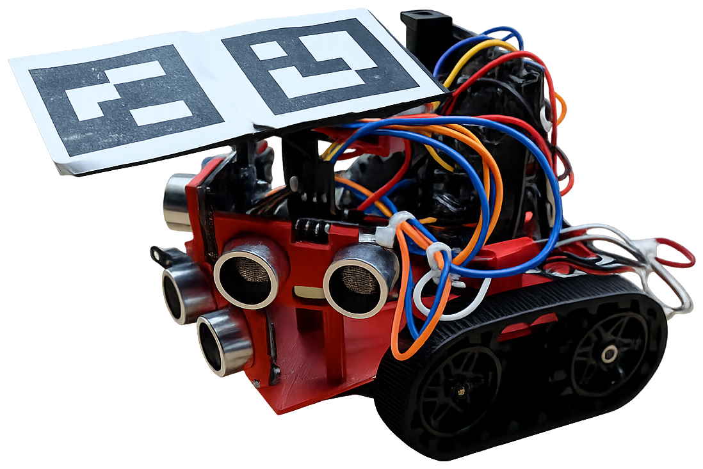
</p>

<p align="center">
  <b>Camera-guided waypoint navigation with ultrasonic obstacle avoidance, running on an ESP8266.</b><br>
  Stevens Institute of Technology · ENGR-122 Final Project · Spring 2026
</p>

<p align="center">
  
  
  
  
  
</p>

A tracked robot that drives itself to a sequence of targets inside an instrumented arena. An overhead camera tracks the ArUco markers on the robot and streams its position and heading over MQTT. On board, a WeMos D1 fuses that pose with three ultrasonic range sensors to steer toward each waypoint while keeping clear of walls and obstacles. The team designed and 3D-printed the chassis, built the circuit without a breadboard, and wrote all navigation, obstacle-avoidance, motor-control and display logic in Arduino C++.

<table>
  <tr><td><b>Task</b></td><td>Reach four assigned targets in order inside the Stevens Smart Arena, pause for two seconds at each, never touch a wall or obstacle, and finish within three minutes.</td></tr>
  <tr><td><b>Sensing</b></td><td>Overhead camera + two 4 cm ArUco markers give global position and heading via MQTT. Three HC-SR04 ultrasonic sensors (front, left, right) give local obstacle distances.</td></tr>
  <tr><td><b>Control</b></td><td>A ~10 Hz loop computes the distance and heading error to the current waypoint, steers with differential track speeds, and overrides steering when something is in range.</td></tr>
  <tr><td><b>Result</b></td><td>Week 13 course run: all 4 targets in order, 52 seconds, 0 collisions.</td></tr>
  <tr><td><b>My role</b></td><td>Software lead: path-planning and obstacle-avoidance algorithms, firmware integration, on-robot debugging, and primary author of the final report.</td></tr>
</table>

## Contents

- [Results](#results)
- [How it works](#how-it-works)
- [Mechanical design](#mechanical-design)
- [Electrical design](#electrical-design)
- [Design process](#design-process)
- [Incremental build-up](#incremental-build-up)
- [Repository layout](#repository-layout)
- [Build and run](#build-and-run)
- [Tuning notes and lessons learned](#tuning-notes-and-lessons-learned)
- [Future work](#future-work)
- [Team](#team)
- [Documents and acknowledgements](#documents-and-acknowledgements)

## Results

<table>
  <tr>
    <td width="40%" valign="top">
      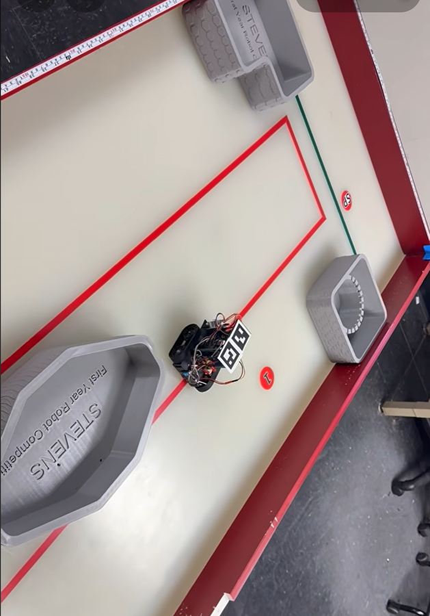
    </td>
    <td valign="top">

**Week 13 course run**

| Metric | Requirement | Achieved |
|---|---|---|
| Targets reached, in order | 4 | **4 / 4** |
| Collisions | 0 | **0** |
| Course time | under 3 min | **52 s** |
| Pause at each target | 2 s | 2 s |
| Subsystems during the run | sensors, motors, display | all functioning |

The robot during testing in the arena. The grey octagons are obstacles and the red line is the course boundary. The overhead camera (out of frame) reads the ArUco markers on the stand to localize the robot, so navigation is driven by real coordinates rather than timed moves.

Earlier hardware problems, a short-circuited board, faulty jumper wires and faulty ultrasonic sensors, were all found and fixed before the graded run. See [lessons learned](#tuning-notes-and-lessons-learned).

   </td>
  </tr>
</table>

## How it works

### System architecture

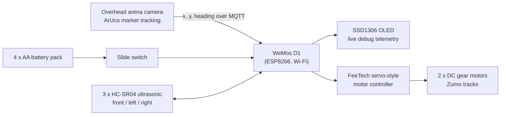

| Subsystem | Part | Role |
|---|---|---|
| Compute | WeMos D1 (ESP8266) | Runs the control loop, Wi-Fi + MQTT client, sensor reads, motor commands |
| Localization | Overhead camera + 2 ArUco markers | Publishes `x`, `y`, `z_ang` (heading) for the robot over MQTT |
| Ranging | 3 x HC-SR04 ultrasonic | Front, left and right obstacle distances in cm |
| Drive | Zumo tracked chassis, 2 DC gear motors, FeeTech servo-style motor controller | Differential drive; commands are servo angles where 90 is stop |
| Feedback | SSD1306 OLED (I²C) | Shows the three distances and the heading error every loop |
| Power | 4 x AA pack through a slide switch | Hard power cut; added after an early short circuit |
| Structure | Custom 3D-printed chassis plate and marker stand | Mounts everything with M1.6 / M2 fasteners, no glue or tape |

<details>
<summary>Input / output diagram from the final report</summary>

<p align="center">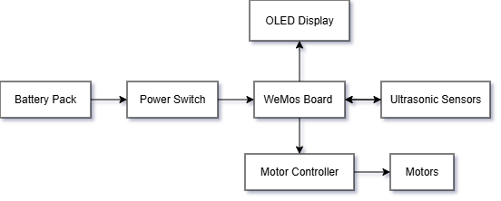</p>

</details>

### 1. Position feedback: where am I?

The arena's camera system detects the ArUco markers on the robot's stand and publishes the robot's position and heading to an MQTT topic on the arena Wi-Fi network. The course-provided `MQTT.h` wrapper handles the connection and parses each message into three globals: `x_robot`, `y_robot` and `z_ang_robot` (heading in degrees). The main loop calls `mqtt_rebound()` and `client.loop()` every tick so those values stay fresh.

### 2. Path planning: where should I go?

The route is a list of waypoints: the four assigned targets plus intermediate points that shape the path around the arena's obstacles. Every loop the firmware computes the vector from the robot to the current waypoint, the straight-line distance, and the heading error between where the robot is pointing and where it should point:

$$
d=\sqrt{dx^2+dy^2}, \qquad
\theta_{\text{desired}}=\mathrm{atan2}(dy, dx), \qquad
e=\theta_{\text{desired}}-\theta_{\text{robot}} \quad\text{wrapped to } [-180^\circ, 180^\circ]
$$

The wrap step matters: without it a robot pointing at 170° with a target at -170° would try to turn 340° the long way around instead of 20° the short way.

Steering uses a dead band so the robot does not hunt around the target heading:

- `e > +15°`: veer left (right track faster than left)
- `e < -15°`: veer right
- otherwise: drive straight

When `d < 100` arena units (about 10 cm) the robot stops, waits two seconds as the rules require, and advances to the next waypoint. After the last waypoint it parks.

```cpp
// firmware/Final_Project/Final_Project.ino (excerpt)
float dx = x_targets[target_index] - x_robot;
float dy = y_targets[target_index] - y_robot;
float distance_to_target = sqrt(dx*dx + dy*dy);

float desired_angle = atan2(dy, dx) * 180 / PI;
float angle_error   = desired_angle - z_ang_robot;
if (angle_error >  180) angle_error -= 360;   // take the short way around
if (angle_error < -180) angle_error += 360;

if (distance_to_target < 100) {               // arrived: pause, next waypoint
    stop();
    target_index++;
    delay(2000);
}

if (distance_middle < 16) {                   // wall or obstacle ahead
    if (distance_left < distance_right) turn_right();
    else                                turn_left();
}
if (distance_left  < 8) right_correction();   // too close on the left
if (distance_right < 8) left_correction();    // too close on the right

if      (angle_error >  15) left_correction();
else if (angle_error < -15) right_correction();
else                        forward();
```

### 3. Obstacle avoidance: what is in my way?

The three ultrasonic sensors are read every loop, staggered by 10 ms so one sensor's ping is not picked up as another's echo. Three rules keep the robot off the walls:

| Condition | Response |
|---|---|
| Front sensor under 16 cm | Pivot roughly 90° toward whichever side has more free space (compares left and right readings) |
| Left sensor under 8 cm | Nudge right |
| Right sensor under 8 cm | Nudge left |

The front rule is a timed in-place pivot, so it completes before path planning resumes. The side rules reuse the same gentle-veer primitives as heading correction.

### 4. The control loop

Each pass through `loop()` takes the same route through the decision tree below, then refreshes the OLED and waits out the remainder of a 100 ms tick, giving a control rate of roughly 10 Hz.

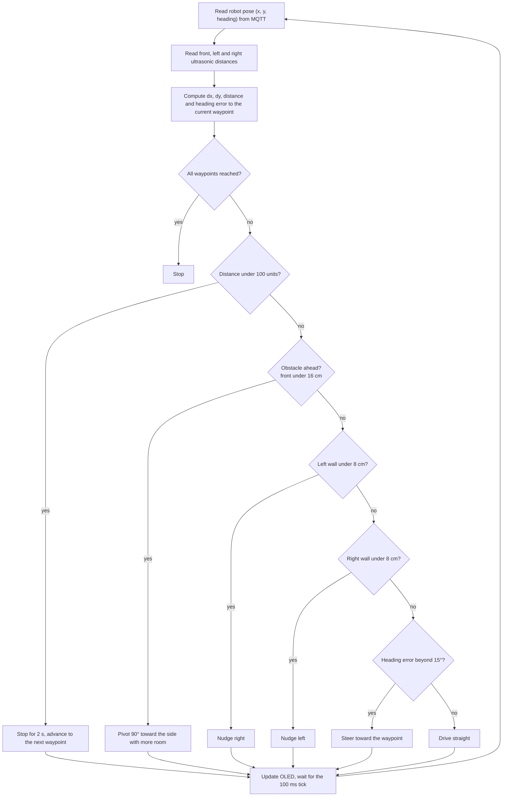

<details>
<summary>Original software flowchart from the final report</summary>

<p align="center">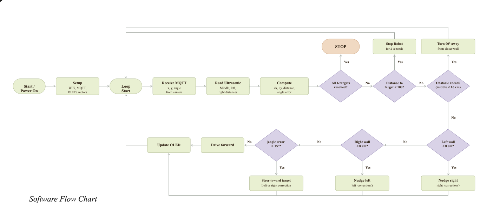</p>

</details>

### 5. Motor primitives

The motor controller takes servo-style commands: 90 stops a track, values above 90 drive it forward and values below 90 reverse it. All motion is built from seven small functions, which kept tuning fast during testing.

| Function | Left track | Right track | Effect |
|---|---|---|---|
| `forward()` | 110 | 109 | Straight ahead; the 1-unit offset cancels a slight pull to one side |
| `stop()` | 90 | 90 | Both tracks stopped |
| `left_correction()` | 107 | 120 | Gentle veer left |
| `right_correction()` | 120 | 107 | Gentle veer right |
| `turn_left()` | 70 | 110 for 720 ms | In-place pivot of about 90° left |
| `turn_right()` | 110 | 70 for 720 ms | In-place pivot of about 90° right |
| `reverse()` | 60 | 60 | Back up |

### 6. On-robot telemetry

The OLED prints the front, left and right distances and the current heading error every loop. During development this is how we caught faulty ultrasonic sensors and jumper wires: a sensor that always read 0 or the maximum range stood out immediately, without plugging in a laptop.

## Mechanical design

The robot is a Zumo tracked chassis topped by two custom parts modeled in SolidWorks and printed on a Flashforge Adventurer: a chassis plate that carries every component, and a stand that holds the two ArUco markers flat and level for the overhead camera.

<p align="center">
  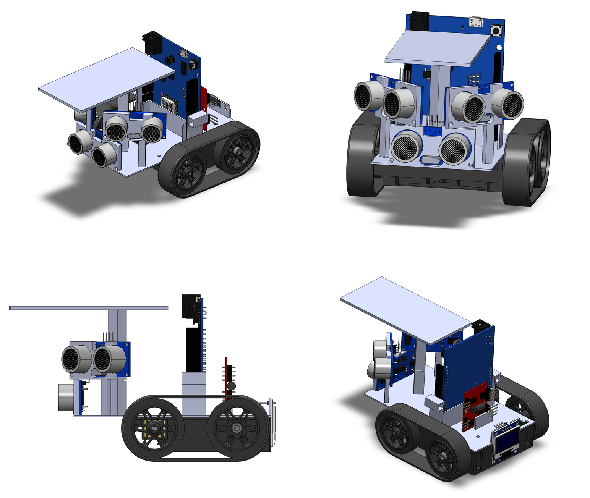
</p>

**Chassis plate.** The plate bolts to the Zumo with M1.6 and M2 hardware. It integrates brackets for the three ultrasonic sensors, with the front sensor mounted low to catch short obstacles and the left and right sensors on the sides of the plate for wall clearance, a vertical mount for the WeMos D1 and motor controller, a mount for the battery pack, and the OLED at the rear where it can be read while the robot drives. Holes in the plate route sensor wiring underneath for cable management.

<table>
  <tr>
    <td width="50%">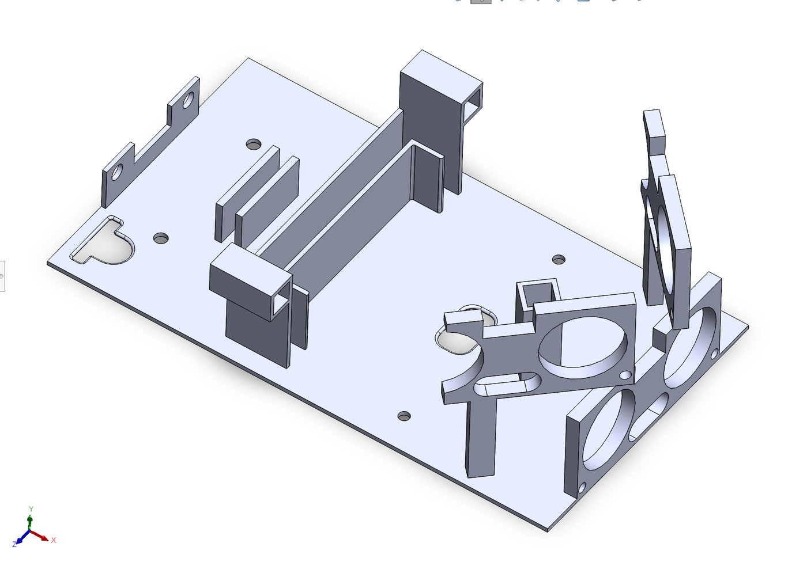</td>
    <td width="50%">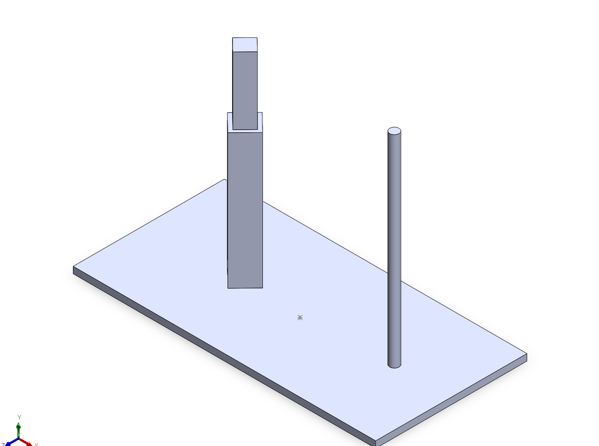</td>
  </tr>
  <tr>
    <td align="center"><sub>Chassis plate with sensor brackets, board mounts and wiring pass-throughs</sub></td>
    <td align="center"><sub>Marker stand. The thin cylinder is a sacrificial column added to fix a print defect (see below)</sub></td>
  </tr>
</table>

**Exploded view and bill of materials.**

<p align="center">
  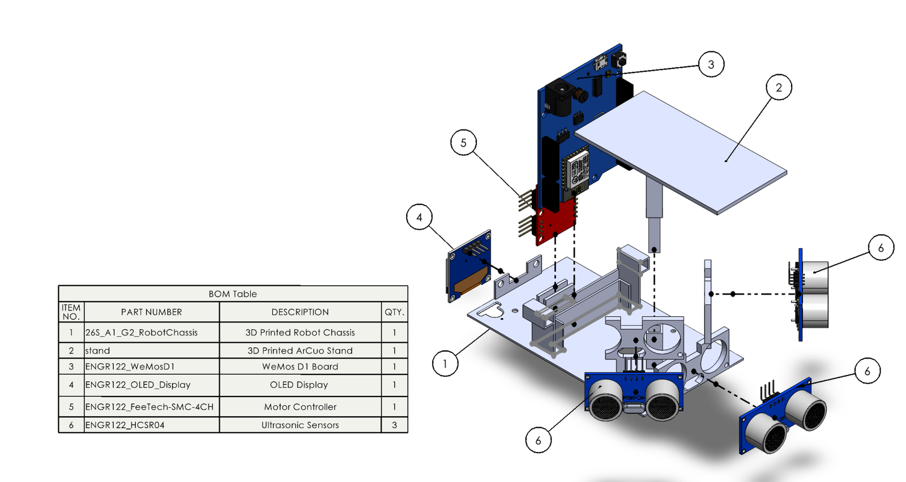
</p>

**3D printing within the constraints.** The rules allowed at most five hours of total print time, with each job short enough to finish in a single lab period. Both parts together print in about 73 minutes.

| Part | Estimated print time | Material |
|---|---|---|
| Chassis plate | 55 min | 23.2 g |
| Marker stand | 18 min | 11.1 g |

<table>
  <tr>
    <td width="50%">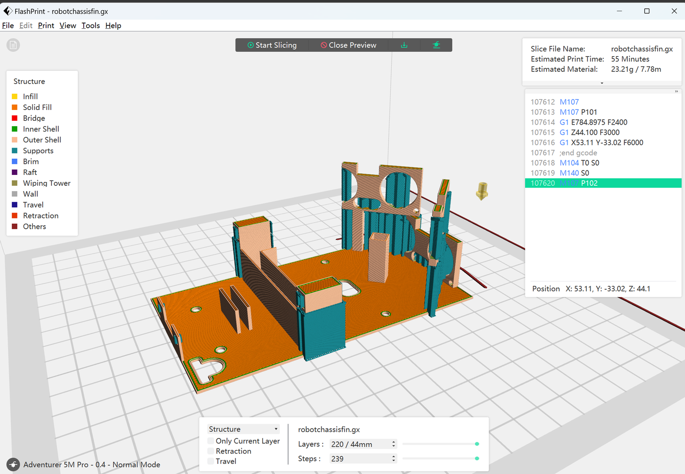</td>
    <td width="50%">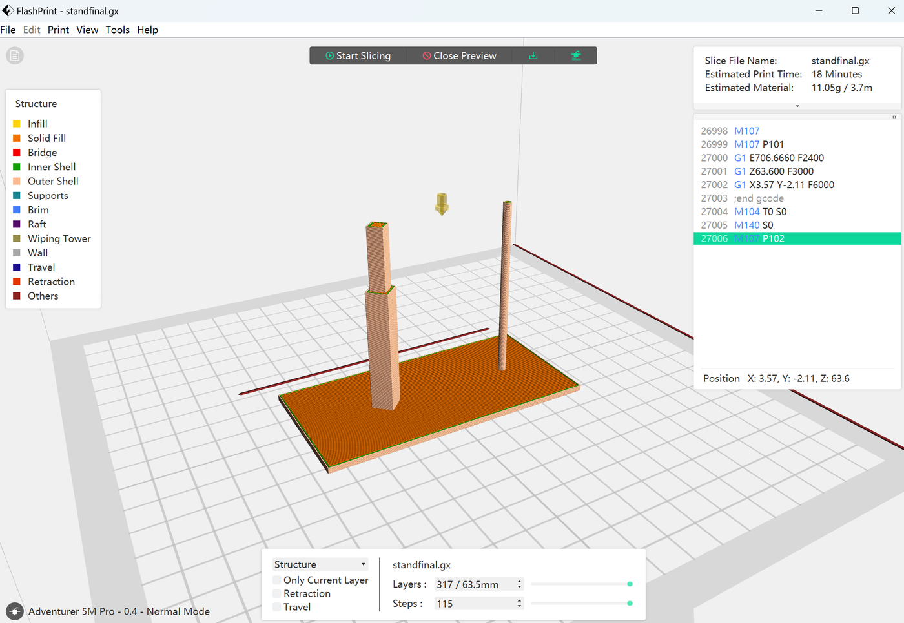</td>
  </tr>
</table>

The stand's tall, thin column failed several times: with so little material per layer the printer never let a layer cool before starting the next, so the peg warped and lost the tight fit it needed. The fix was a "sacrificial" column of the same height placed far from the real one. It forces the nozzle to travel between the two features on every layer, giving each one time to cool, and it snaps off after printing.

**Fasteners.** Zip ties made it quick to pull parts off during prototyping, but the final design had to be glue-, tape- and zip-tie-free, so every mounting hole is toleranced for M1.6 or M2 bolts and hex nuts.

**As built.**

<p align="center">
  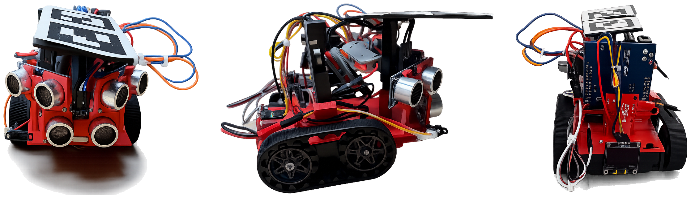
</p>

## Electrical design

<p align="center">
  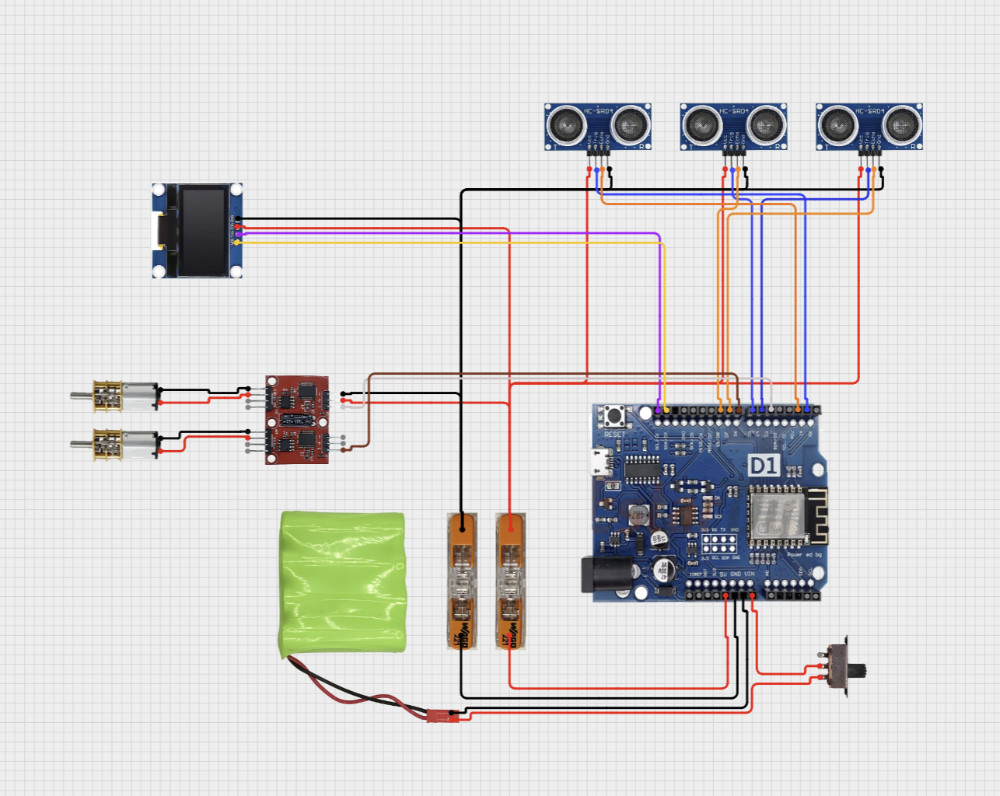
</p>

| WeMos D1 pin | Function | Connected to |
|---|---|---|
| D1 | I²C SCL | OLED SCL |
| D2 | I²C SDA | OLED SDA |
| D3 | PWM | Left motor signal |
| D6 | PWM | Right motor signal |
| D5 / D8 | Trig / Echo | Front ultrasonic |
| D4 / D7 | Trig / Echo | Right ultrasonic |
| TX / D0 | Trig / Echo | Left ultrasonic |

Design decisions worth calling out:

- **No breadboard, no solder.** The rules banned breadboards, and solder joints on other teams' robots kept coming loose during test runs. Power and ground are distributed through lever-style wire connectors instead, which gave solid connections that could still be reworked between test runs.
- **Slide switch on the battery line.** Added after a short circuit took out a WeMos board early in the project. It gives a hard power cut while reprogramming or rewiring.
- **Deliberate pin choices.** D1 and D2 are the board's only I²C pins, so the OLED lives there. The motor signals need PWM-capable pins, so they went to D3 and D6. The remaining PWM-capable pins were assigned to the sensors by testing combinations until none interfered; no pin is shared between components.
- **Color-coded jumper wires** throughout, which made the faulty-wire hunt described below a lot shorter.

## Design process

**Constraints.** Custom 3D-printed body under 6.5 in tall that mounts everything without glue or tape; two 4 cm x 4 cm ArUco markers; at least three ultrasonic sensors, an OLED, a WeMos D1 and a motor controller; no breadboard, color-coded wiring and a slide switch; five hours of total print time with each job inside one lab period; navigation driven by live coordinates rather than timing; four targets in order with a two-second stop at each, no collisions, within three minutes.

**Concept sketches.**

<table>
  <tr>
    <td width="50%">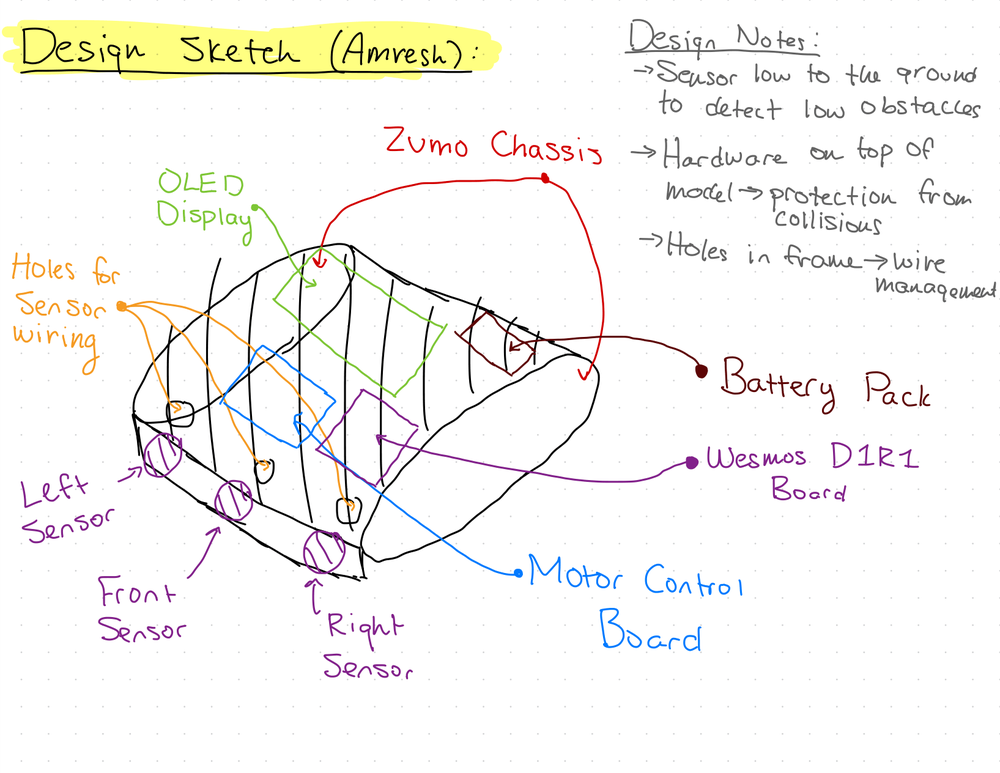</td>
    <td width="50%">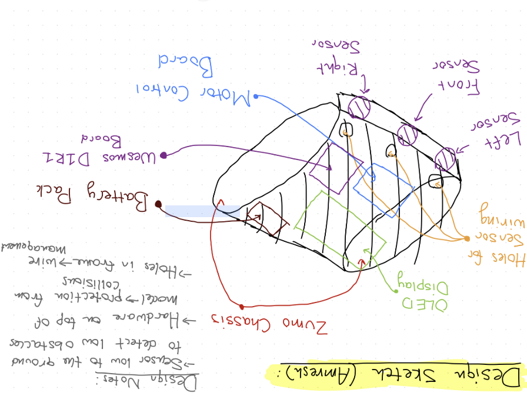</td>
  </tr>
  <tr>
    <td align="center"><sub>Layout sketch: sensors low to the ground, hardware on top of the plate, holes in the frame for wire management</sub></td>
    <td align="center"><sub>Week 2 sketch: bracket-mounted sensors and an upright marker holder</sub></td>
  </tr>
</table>

The first layout put all three sensors across the front face. That made two of them redundant and left the robot blind on its sides, so side-on collisions were not detected. The final layout moves the left and right sensors to the sides of the plate and the OLED to the back where it is readable mid-run. The marker holder also evolved from a slender post into a flat, stable two-marker stand that stays visible to the camera and does not shift while driving.

**Choosing between designs.** A pairwise comparison established what mattered most (mechanical functionality first, then meeting the mechanical constraints, then print time), and a weighted decision matrix scored the two candidate layouts against those priorities. The revised design won decisively, mostly on obstacle avoidance.

<table>
  <tr>
    <td width="60%">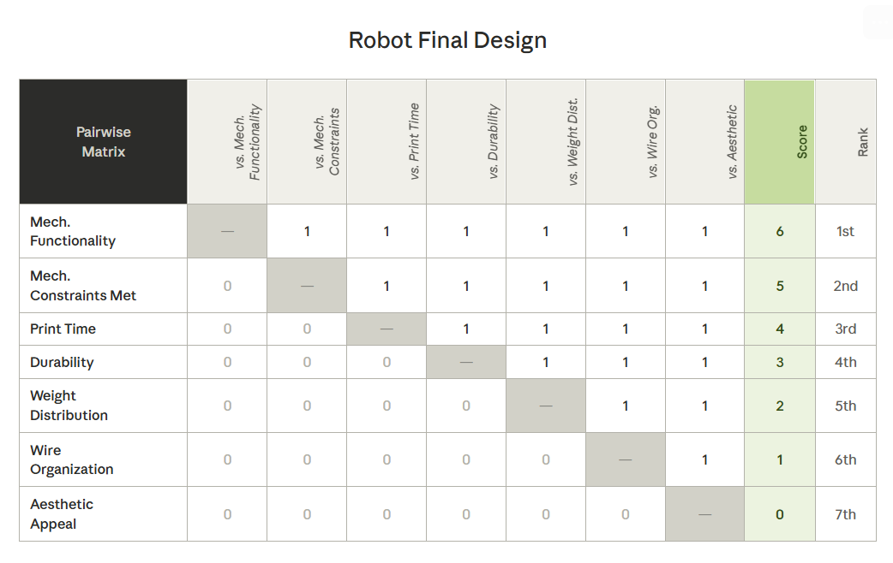</td>
    <td width="40%">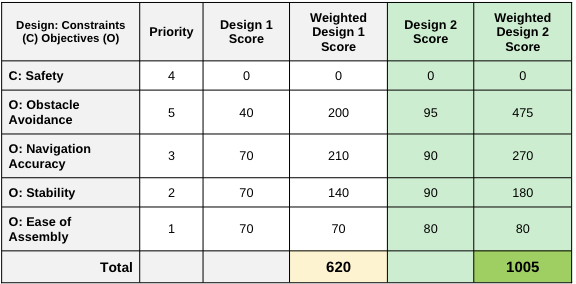</td>
  </tr>
  <tr>
    <td align="center"><sub>Pairwise comparison of design objectives</sub></td>
    <td align="center"><sub>Weighted scores: initial layout 620 vs. revised layout 1005</sub></td>
  </tr>
</table>

**Movement strategy.** Several turning approaches were tried with small test sketches before the final code. Some pivoted too sharply, others not enough to clear an obstacle. Splitting motion into separate primitives (forward, stop, gentle left/right corrections, 90° turns) made it possible to make small heading corrections during normal driving and save the hard pivots for obstacles.

## Incremental build-up

The final sketch was built up through a series of lab tests, each proving one piece before the next was added. They are kept in [`firmware/labs/`](firmware/labs) in build order.

| Stage | Sketch | What it added |
|---|---|---|
| 1 | [`Road_Test_1`](firmware/labs/Road_Test_1/Road_Test_1.ino) | First drive test: bring up both motors and the OLED, print motor commands and distance, and set up the stop-at-wall structure |
| 2 | [`Road_Test_2`](firmware/labs/Road_Test_2/Road_Test_2.ino) | Same behaviour with cleaned-up motor and display handling |
| 3 | [`Road_Test_3`](firmware/labs/Road_Test_3/Road_Test_3.ino) | All three ultrasonic sensors live; stop at 30 cm and perform an in-place 180° turn-around |
| 4 | [`Left_Hand_Loop`](firmware/labs/Left_Hand_Loop/Left_Hand_Loop.ino) | Wall following: 90° left turn at a wall ahead, hold about 9 cm from the right-hand wall with small corrections, to traverse a closed loop |
| 5 | [`Camera_Sensing_Lab`](firmware/labs/Camera_Sensing_Lab/Camera_Sensing_Lab.ino) | Week 7: subscribe to the arena's MQTT topic and show live `x`, `y` and heading on the OLED |
| 6 | [`Final_Project`](firmware/Final_Project/Final_Project.ino) | Waypoint path planning, obstacle avoidance, motor primitives and telemetry integrated into the competition sketch |

## Repository layout

```text
autonomous-navigation-robot/
├── firmware/
│   ├── Final_Project/
│   │   └── Final_Project.ino        # competition sketch: navigation + obstacle avoidance
│   └── labs/                        # incremental test sketches, in build order
│       ├── Road_Test_1/
│       ├── Road_Test_2/
│       ├── Road_Test_3/
│       ├── Left_Hand_Loop/
│       └── Camera_Sensing_Lab/
├── docs/
│   ├── ENGR122_Final_Report.pdf     # 27-page final report
│   ├── ENGR122_Final_Presentation.pptx
│   └── images/                      # figures used in this README
└── README.md
```

## Build and run

1. **Toolchain.** Install Arduino IDE 2.x and the ESP8266 core (Boards Manager URL `http://arduino.esp8266.com/stable/package_esp8266com_index.json`). Select the board **LOLIN(WEMOS) D1 R1**.
2. **Libraries** (Library Manager): *ESP8266 and ESP32 OLED driver for SSD1306 displays* by ThingPulse (provides `SSD1306Wire.h`) and *Ultrasonic* by Erick Simões. `Servo` and `Wire` ship with the ESP8266 core.
3. **MQTT wrapper.** The sketches include a course-provided `MQTT.h` that opens the Wi-Fi connection, subscribes to the arena topic and fills `x_robot`, `y_robot` and `z_ang_robot`. It is course material and is not redistributed in this repository; place it alongside the `.ino` you are building.
4. **Configure the arena.** At the top of `Final_Project.ino`, pick the Wi-Fi network and MQTT topic for the arena you are in (North Arena, South Arena and Integration Lab blocks are provided; uncomment one) and set `x_targets` / `y_targets` to the course's waypoints.
5. **Run.** Upload, place the robot at the start, and flip the slide switch. The OLED shows the three distances and the heading error while it drives.

## Tuning notes and lessons learned

- **Drift compensation.** Equal forward commands pulled slightly to one side; 110 / 109 drives straight.
- **720 ms is a 90° pivot** at 70 / 110 on this chassis and battery. Turn time was tuned empirically, and the Road Test 3 sketch used 1500 ms for a full turn-around.
- **A 15° dead band** was the sweet spot. Tighter thresholds made the robot oscillate around the target heading; looser ones produced wide arcs around targets.
- **100-unit arrival radius.** Large enough that camera jitter and the robot's own length do not make it overshoot and circle back, small enough to count as "at the target".
- **Stagger ultrasonic reads.** 10 ms between the three sensors avoids cross-talk between pings.
- **Hardware failures found by telemetry.** A short-circuited WeMos board led to the slide switch. Faulty jumper wires and faulty ultrasonic sensors were found by watching the OLED readings rather than guessing at the code.
- **Printing a thin tall feature?** Give the printer somewhere else to go on each layer. The sacrificial column turned a part that failed repeatedly into one that printed first time.
- **Design for disassembly during prototyping.** Zip ties early, bolts late. The final holes were toleranced for M1.6 / M2 hardware once the layout had stopped changing.

## Future work

- **Proportional steering.** Scale the track-speed difference with the heading error instead of fixed nudges, for smoother turns and faster convergence on each waypoint.
- **Rear and diagonal coverage.** Additional ultrasonic sensors would let the robot reverse safely and detect obstacles approached at an angle.
- **Obstacle memory.** Record where obstacles were detected in the arena frame and plan around them on later legs instead of reacting each time.
- **Wiring and finish.** Shorter custom-length leads and a wire channel in the plate would tidy the harness and improve the look of the robot.


## Documents and acknowledgements

- [Final report (PDF)](docs/ENGR122_Final_Report.pdf): full design narrative, decision matrices, assembly instructions and the complete source listing.
- [Final presentation (PPTX)](docs/ENGR122_Final_Presentation.pptx): the slide deck from the project showcase.
